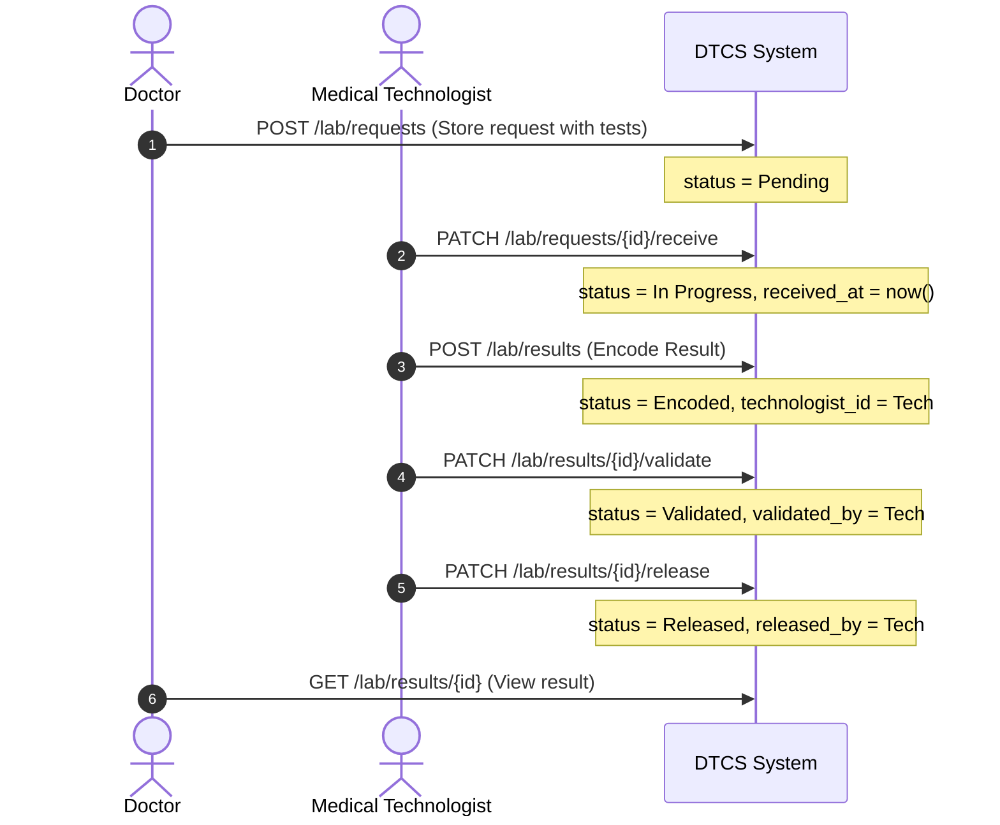
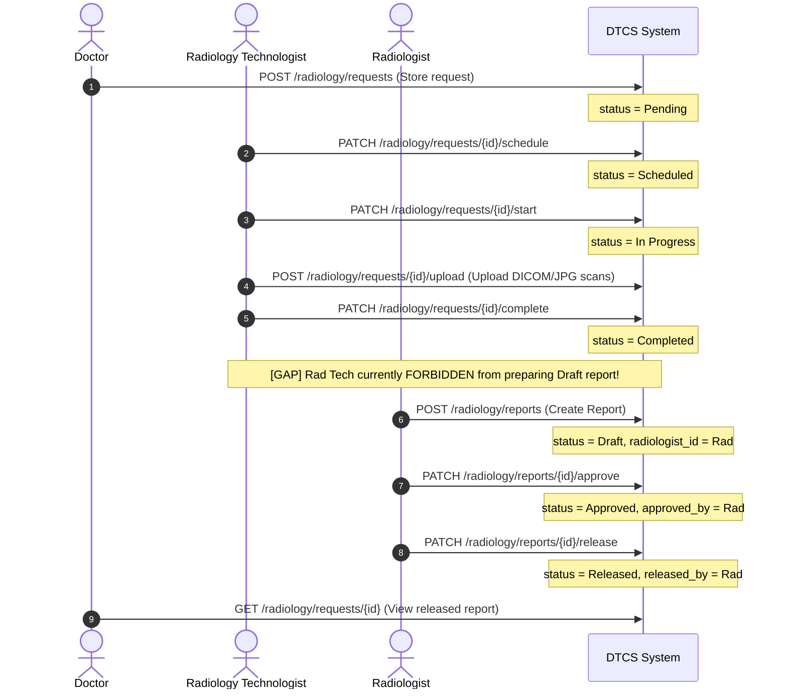

# DTCS HIMS — Diagnostic Services Workflow and Role-Based Access Audit

**Repository:** `Lesthermonleon/DTCS`  
**System:** DTCS Hospital Information Management System  
**Audit Scope:** Laboratory Information System (LIS) & Radiology and Imaging System (RIS)  
**Roles Covered:** Doctor, Laboratory Staff (`med-tech`), Radiology Staff (`rad-tech`), Radiologist (`radiologist`)  
**Date:** November 3, 2026  
**Status:** Audit Completed  

---

## 1. Executive Summary

This audit assesses the current implementation of Diagnostic Services (LIS and RIS) within DTCS HIMS. It evaluates database schema, roles and permissions, controller actions, route authorization, policy rules, sidebar navigation, activity logging, and patient privacy controls.

The audit confirms that the core database tables and columns for LIS and RIS exist in `database/schema/ditc_hms_schema.sql` and the live MySQL database (`ditc_hms`). However, several key architectural, workflow, and authorization gaps were identified:
1. **Sidebar Navigation Gap:** LIS and RIS are not organized under a parent **DIAGNOSTIC SERVICES** group. Staff accounts (`med-tech`, `rad-tech`, `radiologist`) use flat navigation under generic labels instead of the required `DIAGNOSTIC SERVICES` structure.
2. **Role-Permission Binding Gap:** While permission definitions exist in the database, several key permissions are not bound to their corresponding roles (`doctor`, `rad-tech`, `radiologist`), leaving backend checks reliant solely on role strings rather than granular permissions.
3. **Radiology Staff Report Preparation Gap:** `RadiologyReportPolicy` currently restricts all report creation and editing exclusively to `radiologist`. Radiology Staff (`rad-tech`) cannot prepare preliminary reports, save drafts, or submit reports for radiologist review as mandated by Phase 5.
4. **Radiologist Return-for-Correction Gap:** There is no dedicated action or state transition for a Radiologist to return a preliminary report back for correction with clinical notes.
5. **LIS Specimen Lifecycle & Permission Granularity:** Specimen rejection with reason capture is missing. While route middleware checks permissions for validation and release, the controller and UI views do not check `lis.results.verify` or `lis.results.release`, allowing any `med-tech` to trigger validation/release in the UI.
6. **Patient Privacy & Scoping Vulnerabilities:** Doctors can potentially view unreleased lab results or another doctor's unapproved radiology reports via direct URL parameters, violating clinical access boundaries.

---

## 2. Existing Roles and User Structure

Inspection of `roles`, `role_user`, and `users` confirms the following four diagnostic roles are active in the system:

| Role Name | Slug | Dashboard Route | Intended Operational Responsibility |
| :--- | :--- | :--- | :--- |
| **Doctor** | `doctor` | `doctor.dashboard` | Ordering diagnostic tests/imaging, tracking requests, reviewing released results & approved reports. |
| **Medical Technologist** | `med-tech` | `lab.dashboard` | Processing specimens, recording collection/receipt/rejection, entering results, validating & releasing (if authorized). |
| **Radiologic Technologist** | `rad-tech` | `radiology.dashboard` | Scheduling & performing imaging exams, uploading scans, preparing draft reports for radiologist review. |
| **Radiologist** | `radiologist` | `radiology.dashboard` | Professional interpretation, reviewing technologist reports, approving & finalizing reports, returning for correction. |

**Audit Finding:** All four necessary roles exist. No new roles should be created.

---

## 3. Existing Permissions Analysis

Inspection of `permissions` and `permission_role`:

### Currently Defined Diagnostic Permissions:
- `diagnostics.order` (ID 4, Module: Clinical Care)
- `lis.results.enter` (ID 7, Module: Laboratory)
- `lis.results.release` (ID 8, Module: Laboratory)
- `lis.results.verify` (ID 30, Module: Laboratory)
- `ris.images.upload` (ID 9, Module: Radiology)
- `ris.reports.release` (ID 10, Module: Radiology)

### Role Binding Discrepancies:
- `med-tech`: Has `lis.results.enter`, `lis.results.verify`, `lis.results.release` bound in `permission_role`.
- `doctor`: Has **0** permissions bound in `permission_role` (even though `diagnostics.order` exists).
- `rad-tech`: Has **0** permissions bound in `permission_role` (even though `ris.images.upload` exists).
- `radiologist`: Has **0** permissions bound in `permission_role` (even though `ris.reports.release` exists).

### Missing Granular Permissions (Phase 8 Requirements):
To fulfill Phase 8, the following granular permissions must be explicitly defined and bound:
1. `lis.requests.view` — View laboratory requests
2. `lis.requests.create` — Order laboratory tests
3. `lis.specimens.process` — Receive, collect, and reject laboratory specimens
4. `lis.results.enter` — Enter/draft laboratory results (Existing)
5. `lis.results.verify` — Validate laboratory results (Existing)
6. `lis.results.release` — Release laboratory results (Existing)
7. `ris.requests.view` — View imaging requests
8. `ris.requests.create` — Order radiology imaging
9. `ris.procedures.manage` — Schedule, start, complete exams & upload images
10. `ris.reports.prepare` — Prepare and draft preliminary radiology reports
11. `ris.reports.review` — Review radiology reports
12. `ris.reports.approve` — Approve and finalize radiology reports
13. `diagnostics.results.view` — View released diagnostic results and approved reports

---

## 4. Current LIS (Laboratory) Workflow Analysis

### 4.1. Models and Schema
- `LabRequest`: `request_no`, `patient_id`, `doctor_id`, `priority` (Routine/Urgent/STAT), `status` (Pending/In Progress/Completed/Cancelled), `clinical_notes`, `specimen_type`, `requested_at`, `received_at`, `completed_at`.
- `LabRequestItem`: `lab_request_id`, `lab_test_id`, `status` (Pending/In Progress/Completed).
- `LabResult`: `lab_request_item_id`, `technologist_id`, `result_value`, `remarks`, `status` (Pending/Encoded/Validated/Released), `validated_by`, `released_by`, `validated_at`, `released_at`.

### 4.2. Current Workflow

### 4.3. Identified Gaps & Deficiencies
1. **Specimen Rejection Missing:** Technologists cannot record specimen rejection (e.g. hemolyzed, clotted, insufficient volume, mismatched label) with rejection reason.
2. **Premature Results Visibility:** In `LabResultController::index` and `show`, unreleased results (`Pending`, `Encoded`, `Validated`) are not hidden from Doctors. Doctors must only see `Released` results.
3. **Cross-Doctor Leakage:** `LabResultController::index` does not scope queries for doctors. Doctors should only see lab results for their own patients.
4. **Validation/Release Separation:** `LabResultController::validate` and `release` only check `hasRole('med-tech')` in controller code; they must also enforce `hasPermission('lis.results.verify')` and `hasPermission('lis.results.release')`.
5. **UI Button Visibility:** `resources/views/lab/requests/show.blade.php` shows Validate and Release buttons to any user with role `med-tech` without checking their specific permission.

---

## 5. Current RIS (Radiology) Workflow Analysis

### 5.1. Models and Schema
- `RadiologyRequest`: `request_no`, `patient_id`, `doctor_id`, `modality`, `body_part`, `clinical_information`, `priority`, `status` (Pending/Scheduled/In Progress/Completed/Cancelled), `requested_at`, `scheduled_at`, `completed_at`.
- `RadiologyImage`: `radiology_request_id`, `file_path`, `file_name`, `file_type`, `file_size`, `uploaded_by`, `uploaded_at`, `notes`.
- `RadiologyReport`: `radiology_request_id`, `radiologist_id`, `findings`, `impression`, `recommendations`, `status` (Draft/Approved/Released), `approved_by`, `released_by`, `approved_at`, `released_at`.

### 5.2. Current Workflow

### 5.3. Identified Gaps & Deficiencies
1. **Technologist Cannot Prepare Drafts:** `RadiologyReportPolicy::create` and `update` currently abort with 403 for `rad-tech`. Phase 5 specifically mandates allowing authorized Radiology Staff to prepare preliminary reports, save drafts, and submit reports for Radiologist review.
2. **No Return-for-Correction Workflow:** If a Radiologist finds issues with a preliminary report, there is no workflow to return it for correction with notes.
3. **Draft Report Leakage:** `RadiologyReportController::index` and `show` do not prevent Doctors from viewing draft/unapproved reports or other doctors' patient reports.
4. **Approval Exclusivity:** Ensure only users with `radiologist` role and `ris.reports.approve` permission can approve/finalize reports. Staff must never bypass approval.

---

## 6. Sidebar Navigation Audit

### 6.1. Current Sidebar Structure
In `resources/views/partials/_sidebar.blade.php`:
- **Doctor:** Lists LIS and RIS under `CLINICAL MODULES` alongside Pharmacy, Surgery, and Nutrition. There is no parent `DIAGNOSTIC SERVICES` group.
- **Medical Technologist (`med-tech`):** Flat list under `CLINICAL` (Lab Requests, Lab Results, Lab Reports). No `DIAGNOSTIC SERVICES` parent group.
- **Radiology Technologist (`rad-tech`):** Flat list under `CLINICAL` (Imaging Requests, Radiology Reports). No `DIAGNOSTIC SERVICES` parent group.
- **Radiologist (`radiologist`):** Flat list under `CLINICAL` (Imaging Requests, Reports, Radiology Reports). No `DIAGNOSTIC SERVICES` parent group.

### 6.2. Required Sidebar Organization (Phase 2 & 10)
A dedicated parent navigation group must be introduced:

**DIAGNOSTIC SERVICES**
- **Laboratory (LIS)**
  - Overview / Dashboard
  - Lab Requests
  - Lab Results
- **Radiology (RIS)**
  - Overview / Dashboard
  - Imaging Requests
  - Reports

#### Visibility by Role:
- **Doctor:**
  - `DIAGNOSTIC SERVICES` -> Laboratory (LIS) & Radiology (RIS)
  - `CLINICAL MODULES` -> Pharmacy (PMS), Surgery (SORS), Nutrition (DNMS)
- **Medical Technologist (`med-tech`):**
  - `DIAGNOSTIC SERVICES` -> Laboratory (LIS) only (No RIS, PMS, SORS, DNMS)
- **Radiologic Technologist (`rad-tech`):**
  - `DIAGNOSTIC SERVICES` -> Radiology (RIS) only (No LIS, PMS, SORS, DNMS)
  - Reports menu exposes report preparation/drafting
- **Radiologist (`radiologist`):**
  - `DIAGNOSTIC SERVICES` -> Radiology (RIS) only (No LIS, PMS, SORS, DNMS)
  - Reports menu exposes report interpretation & approval

---

## 7. Required Changes Plan

### 7.1. Database / Permission Seed Changes
- Ensure all 13 diagnostic permissions exist in `permissions`.
- Bind permissions to roles:
  - `doctor`: `diagnostics.order`, `lis.requests.view`, `lis.requests.create`, `ris.requests.view`, `ris.requests.create`, `diagnostics.results.view`.
  - `med-tech`: `lis.requests.view`, `lis.specimens.process`, `lis.results.enter`, `lis.results.verify`, `lis.results.release`.
  - `rad-tech`: `ris.requests.view`, `ris.procedures.manage`, `ris.images.upload`, `ris.reports.prepare`.
  - `radiologist`: `ris.requests.view`, `ris.reports.review`, `ris.reports.approve`, `ris.reports.release`.

### 7.2. Controller & Policy Enhancements
1. **`RadiologyReportPolicy` & `RadiologyReportController`:**
   - Allow `rad-tech` to access `create` and `store` for draft reports when holding `ris.reports.prepare`.
   - Prevent `rad-tech` from approving (`approve`) or releasing (`release`) reports.
   - Implement `returnForCorrection(RadiologyReport $report, Request $request)` for radiologists.
   - Restrict Doctor viewing to `Approved` or `Released` reports belonging to their own patients.
2. **`LabRequestController` & `LabResultController`:**
   - Add `reject(LabRequest $labRequest, Request $request)` for specimen rejection with reason recording.
   - Restrict `validate` and `release` actions to users with `lis.results.verify` and `lis.results.release`.
   - Restrict Doctor viewing in `LabResultController` to `Released` results belonging to their own patients.
   - Preserve `technologist_id`, `validated_by`, `released_by` audit attributes.
3. **`RadiologyRequestController`:**
   - Restrict Doctor viewing in `show` to their own patients.
4. **Activity Logging:**
   - Log specimen rejection, report preparation, submission, approval, return, and release.

### 7.3. Sidebar Alignment
- Update `resources/views/partials/_sidebar.blade.php`:
  - Introduce `DIAGNOSTIC SERVICES` parent section.
  - Implement role-specific scoping for Doctor, Med-Tech, Rad-Tech, and Radiologist.
  - Retain other authorized modules for Doctor (PMS, SORS, DNMS) without alteration.

---

## 8. Potential Database Changes

No table drops, alter columns, or destructive operations are required:
- Live database already contains `lab_requests`, `lab_request_items`, `lab_results`, `radiology_requests`, `radiology_images`, and `radiology_reports`.
- Missing permissions will be idempotently inserted into `permissions` and bound to roles via `permission_role`.
- Specimen rejection reason can be recorded in `lab_requests.clinical_notes` (e.g. `[Specimen Rejected]: Reason text`) and logged in `activity_logs`.
- Report return-for-correction can be recorded in `radiology_reports.recommendations` / `findings` review notes and logged in `activity_logs`.

---

## 9. Conclusion

The existing codebase provides a solid foundation with established tables and controllers. Implementing the parent `DIAGNOSTIC SERVICES` sidebar, binding granular permissions to roles, enabling Radiology Staff preliminary report preparation while strictly reserving approval for Radiologists, adding specimen rejection and report return workflows, and enforcing patient privacy scoping will fully align DTCS with clinical specifications.
