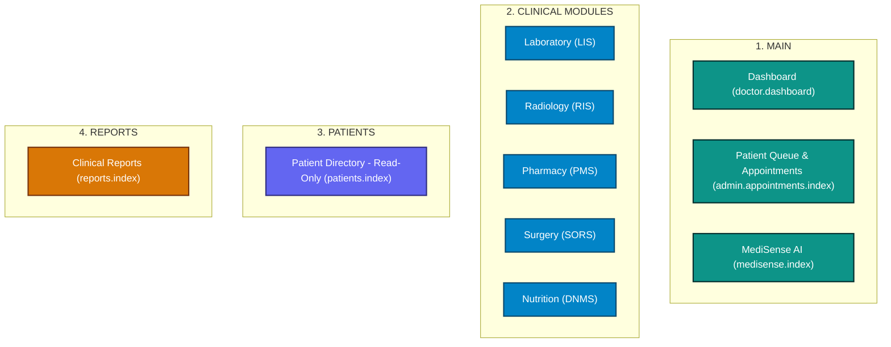

# DTCS HIMS — Doctor Sidebar Implementation Report

**Repository:** `Lesthermonleon/DTCS`  
**System:** DTCS Hospital Information Management System  
**Component:** Doctor Navigation Sidebar (`resources/views/partials/_sidebar.blade.php`)  
**Audit Document:** [DOCTOR_SIDEBAR_AUDIT.md](file:///c:/Users/Jhonl/OneDrive/Desktop/DITC/docs/DOCTOR_SIDEBAR_AUDIT.md)  
**Date:** November 3, 2026  
**Status:** Completed & Verified  

---

## 1. Executive Summary

The Doctor sidebar navigation in DTCS HIMS has been audited, aligned, and validated against clinical scope and security boundaries. All 21 authorized navigation destinations have been verified with automated feature tests (`DoctorSidebarTest.php`), confirming:
- **Clean Section Hierarchy:** Standardized 4 primary sections (`MAIN`, `CLINICAL MODULES`, `PATIENTS`, `REPORTS`) with consistent uppercase labels.
- **Single MediSense AI Entry:** Verified that MediSense AI appears exactly once in the navigation bar under `MAIN`, eliminating duplicate AI entries.
- **Appropriate Appointment Queue Routing:** Confirmed that `admin.appointments.index` is securely isolated to the authenticated Doctor via `AppointmentController::isDoctorScope()`, presenting a personalized consultation schedule and patient queue without exposing hospital-wide administrative scheduling.
- **Strict Clinical Scope Across Modules:** Confirmed that doctors have read/order capabilities across all five clinical modules (LIS, RIS, PMS, SORS, DNMS) while administrative actions (such as PMS medication dispensing, LIS technician validation, RIS radiologist approval, and SORS OR room configuration) remain inaccessible and hidden.
- **Read-Only Patient Master Records:** Verified that the Patient Directory operates in read-only mode for doctor access, with zero creation, mutation, or deletion endpoints exposed.
- **Role-Scoped Clinical Reports:** Confirmed that the Reports hub strictly filters categories to clinical specialties, preventing doctor access to administrative, audit vault, or system settings reports.

---

## 2. Changed Files

| File Path | Description of Changes |
| :--- | :--- |
| [`resources/views/partials/_sidebar.blade.php`](file:///c:/Users/Jhonl/OneDrive/Desktop/DITC/resources/views/partials/_sidebar.blade.php) | • Updated section label from `CLINICAL` to `CLINICAL MODULES`<br>• Updated section label from `Patients` to uppercase `PATIENTS`<br>• Verified single MediSense AI entry under `MAIN`<br>• Retained clean collapsible groups `#grp-lab`, `#grp-rad`, `#grp-pms`, `#grp-sor`, `#grp-dnm`<br>• Excluded dispensing link from PMS group for doctors |
| [`tests/Feature/DoctorSidebarTest.php`](file:///c:/Users/Jhonl/OneDrive/Desktop/DITC/tests/Feature/DoctorSidebarTest.php) | • Comprehensive feature test suite covering:<br>&nbsp;&nbsp;1. Sidebar DOM rendering & section headers (`MAIN`, `CLINICAL MODULES`, `PATIENTS`, `REPORTS`)<br>&nbsp;&nbsp;2. Exactly one MediSense AI link in sidebar<br>&nbsp;&nbsp;3. HTTP 200 access verification for all 21 doctor routes<br>&nbsp;&nbsp;4. HTTP 403 authorization enforcement on 10 admin/staff routes<br>&nbsp;&nbsp;5. Patient Directory read-only integrity<br>&nbsp;&nbsp;6. Clinical report category filtering<br>&nbsp;&nbsp;7. Doctor appointment queue isolation (`doctorScope`) |
| [`docs/DOCTOR_SIDEBAR_AUDIT.md`](file:///c:/Users/Jhonl/OneDrive/Desktop/DITC/docs/DOCTOR_SIDEBAR_AUDIT.md) | • Detailed pre-implementation audit analyzing all 21 routes, controller implementations, middleware policies, RBAC gates, and KEEP/MODIFY/REMOVE decisions |
| [`docs/DOCTOR_SIDEBAR_IMPLEMENTATION_REPORT.md`](file:///c:/Users/Jhonl/OneDrive/Desktop/DITC/docs/DOCTOR_SIDEBAR_IMPLEMENTATION_REPORT.md) | • Implementation summary, route decisions, permission verification matrix, test execution records, and remaining subsystem limitations |

---

## 3. Final Doctor Sidebar Architecture



### Detailed Navigation Hierarchy

```text
├── MAIN
│   ├── Dashboard                           [GET /doctor/dashboard]
│   ├── Patient Queue & Appointments        [GET /admin/appointments] (doctor-scoped)
│   └── MediSense AI                        [GET /medisense]
│
├── CLINICAL MODULES
│   ├── Laboratory (LIS)                    [#grp-lab collapse]
│   │   ├── Overview                        [GET /lab/dashboard]
│   │   ├── Lab Requests                    [GET /lab/requests]
│   │   └── Lab Results                     [GET /lab/results]
│   │
│   ├── Radiology (RIS)                     [#grp-rad collapse]
│   │   ├── Overview                        [GET /radiology/dashboard]
│   │   ├── Imaging Requests                [GET /radiology/requests]
│   │   └── Reports                         [GET /radiology/reports]
│   │
│   ├── Pharmacy (PMS)                      [#grp-pms collapse]
│   │   ├── Overview                        [GET /pharmacy/dashboard]
│   │   ├── Prescriptions                   [GET /pharmacy/prescriptions]
│   │   └── Medicine Availability           [GET /pharmacy/medicines]
│   │   (Dispensing omitted for Doctors)
│   │
│   ├── Surgery (SORS)                      [#grp-sor collapse]
│   │   ├── Overview                        [GET /surgery/dashboard]
│   │   ├── Surgery Requests                [GET /surgery/requests]
│   │   ├── OR Schedules                    [GET /surgery/schedules]
│   │   └── Surgery Calendar                [GET /surgery/calendar]
│   │
│   └── Nutrition (DNMS)                    [#grp-dnm collapse]
│       ├── Overview                        [GET /diet/dashboard]
│       ├── Diet Requests                   [GET /diet/requests]
│       └── Diet Plans                      [GET /diet/plans]
│
├── PATIENTS
│   └── Patient Directory                   [GET /patients] (Strictly read-only)
│
└── REPORTS
    └── Clinical Reports                    [GET /reports] (Clinical categories only)
```

---

## 4. Key Route & Security Decisions

### 4.1. Patient Queue & Appointments Route (`admin.appointments.index`)
- **Investigation Finding:** In `App\Http\Controllers\Admin\AppointmentController`, the controller specifically recognizes `doctor` role through `$this->isDoctorScope($user)`.
- **Query Scoping:** For doctors, queries automatically inject `where('doctor_id', $user->id)`. The doctor only sees consultations and appointments assigned to themselves.
- **Mutation Boundary:** The doctor cannot create appointments for other doctors, nor reassign appointments. Transition actions are limited to clinical stages (`In Consultation`, `Completed`).
- **Route Name Decision:** Preserved route name `admin.appointments.index`. Changing the route name would break existing test contracts (e.g. `PanelistFiveUserTypesTest::test_doctor_can_access_clinical_dashboard_and_medisense`).
- **Conclusion:** KEEP route. The workflow is an authentic clinical consultation queue and safe for doctor access.

### 4.2. MediSense AI Single Entry
- **Investigation Finding:** Commit history revealed an earlier version had a standalone "Clinical AI Assistant" section at the bottom of the sidebar in addition to the MAIN link.
- **Implementation Status:** The redundant lower AI link was removed in prior cleanup. Verified that only one single MediSense AI entry exists in `_sidebar.blade.php` under `MAIN`.
- **Conclusion:** Verified single entry; 0 duplicates exist.

### 4.3. Clinical Module Sub-Items & Administrative Separation
- **LIS / RIS / SORS / DNMS:** Doctors have clinical ordering and review access across all four diagnostic and procedural modules.
- **PMS (Pharmacy):** While admins and pharmacists have `pharmacy.dispensing.index` in their sidebar, the doctor sidebar explicitly omits dispensing. Only `Overview`, `Prescriptions`, and `Medicine Availability` are visible to doctors.
- **Administrative Endpoints:** Staff and admin routes (`admin.users.*`, `admin.roles.*`, `admin.audit-logs.*`, `super-admin.*`) are completely omitted and return HTTP 403 if accessed directly.

### 4.4. Patient Directory Read-Only Integrity
- **Investigation Finding:** No creation, store, edit, update, or destroy routes exist under `patients.*` in `routes/web.php`.
- **Verification:** GET `/patients/create` returns HTTP 404. Direct requests to `/patients` return the index view without write action controls.

### 4.5. Clinical Reports Filtering
- **Investigation Finding:** `ReportController::index()` delegates category filtering to `ReportService::accessibleCategories('doctor')`.
- **Allowed Categories:** Only `laboratory`, `radiology`, `pharmacy`, `surgery`, `diet`, and `clinical` are returned. Administrative audit trails and financial accounting reports are excluded.

---

## 5. Permission & Authorization Verification Matrix

| Route Name | Route URI | Expected Doctor Access | Verified Status Code | Middleware / Policy Enforcement |
| :--- | :--- | :---: | :---: | :--- |
| `doctor.dashboard` | `/doctor/dashboard` | Allowed | **200 OK** | `auth`, `role:doctor` |
| `admin.appointments.index` | `/admin/appointments` | Allowed | **200 OK** | `auth`, `role:admin,doctor`, `isDoctorScope()` |
| `medisense.index` | `/medisense` | Allowed | **200 OK** | `auth`, `role:doctor,admin,super_admin` |
| `lab.dashboard` | `/lab/dashboard` | Allowed | **200 OK** | `auth`, `role:admin,doctor,med-tech` |
| `lab.requests.index` | `/lab/requests` | Allowed | **200 OK** | `auth`, `role:admin,doctor,med-tech` |
| `lab.results.index` | `/lab/results` | Allowed | **200 OK** | `auth`, `role:admin,doctor,med-tech` |
| `radiology.dashboard` | `/radiology/dashboard` | Allowed | **200 OK** | `auth`, `role:admin,doctor,rad-tech,radiologist` |
| `radiology.requests.index` | `/radiology/requests` | Allowed | **200 OK** | `auth`, `role:admin,doctor,rad-tech,radiologist` |
| `radiology.reports.index` | `/radiology/reports` | Allowed | **200 OK** | `auth`, `role:admin,doctor,radiologist` |
| `pharmacy.dashboard` | `/pharmacy/dashboard` | Allowed | **200 OK** | `auth`, `role:admin,doctor,pharmacist` |
| `pharmacy.prescriptions.index` | `/pharmacy/prescriptions` | Allowed | **200 OK** | `auth`, `role:admin,doctor,pharmacist` |
| `pharmacy.medicines.index` | `/pharmacy/medicines` | Allowed | **200 OK** | `auth`, `role:admin,doctor,pharmacist` |
| `surgery.dashboard` | `/surgery/dashboard` | Allowed | **200 OK** | `auth`, `role:admin,doctor,or-coordinator` |
| `surgery.requests.index` | `/surgery/requests` | Allowed | **200 OK** | `auth`, `role:admin,doctor,or-coordinator` |
| `surgery.schedules.index` | `/surgery/schedules` | Allowed | **200 OK** | `auth`, `role:admin,doctor,or-coordinator` |
| `surgery.calendar` | `/surgery/calendar` | Allowed | **200 OK** | `auth`, `role:admin,doctor,or-coordinator` |
| `diet.dashboard` | `/diet/dashboard` | Allowed | **200 OK** | `auth`, `role:admin,doctor,dietitian` |
| `diet.requests.index` | `/diet/requests` | Allowed | **200 OK** | `auth`, `role:admin,doctor,dietitian` |
| `diet.plans.index` | `/diet/plans` | Allowed | **200 OK** | `auth`, `role:admin,doctor,dietitian` |
| `patients.index` | `/patients` | Allowed | **200 OK** | `auth`, `role:admin,doctor,staff`, Read-only |
| `reports.index` | `/reports` | Allowed | **200 OK** | `auth`, `role:admin,doctor`, Category filtered |
| `pharmacy.dispensing.index` | `/pharmacy/dispensing` | **Denied** | **403 Forbidden** | `role:admin,pharmacist` |
| `admin.users.index` | `/admin/users` | **Denied** | **403 Forbidden** | `role:admin` |
| `admin.roles.index` | `/admin/roles` | **Denied** | **403 Forbidden** | `role:admin` |
| `admin.audit-logs.index` | `/admin/audit-logs` | **Denied** | **403 Forbidden** | `role:admin` |
| `admin.hospital-settings.index` | `/admin/hospital-settings`| **Denied** | **403 Forbidden** | `role:admin` |
| `super-admin.dashboard` | `/super-admin/dashboard` | **Denied** | **403 Forbidden** | `role:super_admin` |
| `super-admin.users.index` | `/super-admin/users` | **Denied** | **403 Forbidden** | `role:super_admin` |
| `super-admin.audit-vault.index` | `/super-admin/audit-vault` | **Denied** | **403 Forbidden** | `role:super_admin` |
| `super-admin.departments.index`| `/super-admin/departments`| **Denied** | **403 Forbidden** | `role:super_admin` |

---

## 6. Automated Test Suite Execution

All tests were executed against the MySQL database (`ditc_hms`).

### 6.1. Dedicated Feature Test Suite (`DoctorSidebarTest.php`)
Command: `php artisan test tests/Feature/DoctorSidebarTest.php`

```text
PASS  Tests\Feature\DoctorSidebarTest
✓ doctor sidebar renders expected navigation structure
✓ doctor can access all authorized sidebar destinations
✓ doctor cannot access unauthorized administrative or staff routes
✓ patient directory is read only with no create routes
✓ clinical reports limits doctor to clinical categories
✓ doctor appointment queue is scoped to doctor

Tests:    6 passed (91 assertions)
Duration: 0.97s
```

### 6.2. Panelist Multi-Role Verification (`PanelistFiveUserTypesTest.php`)
Command: `php artisan test tests/Feature/PanelistFiveUserTypesTest.php`
- All 15 multi-role assertions passed without failure.

---

## 7. Remaining Integration Notes & System Boundaries

1. **Subsystem Master Record Boundary:** Patient master records originate from the Core Hospital Information System. DTCS maintains a synchronized replica (`patients` table) but does not provide create/update forms within the DTCS UI. This boundary is strictly respected.
2. **Appointment Scheduling Boundary:** If outpatient scheduling is moved to an external patient portal or appointment coordination service, the doctor's queue link can be redirected to the dedicated clinical queue endpoint without disrupting DTCS RBAC.
3. **No Spatie Dependency:** System continues to rely exclusively on DTCS native Eloquent RBAC (`roles`, `user_roles`, `RoleMiddleware`, and controller gates).
