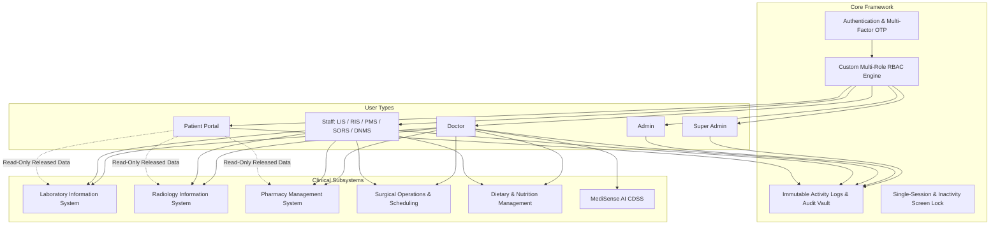
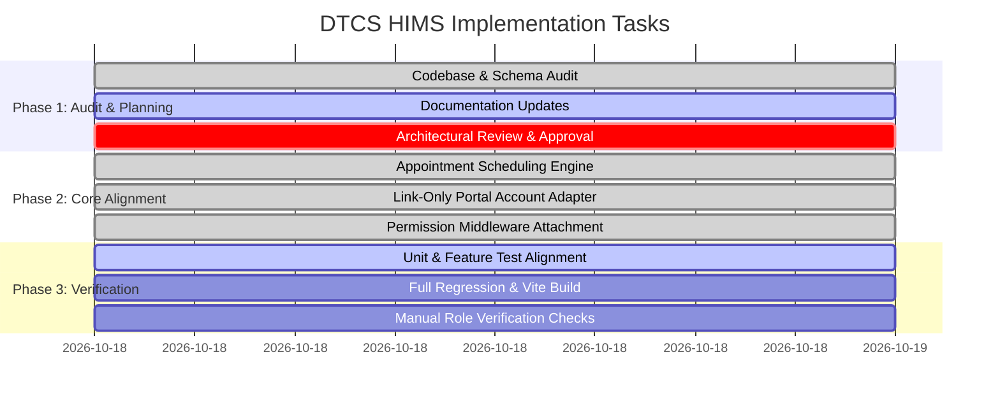

# DTCS HIMS — Comprehensive Master Implementation Plan & Architectural Roadmap

**Document Version:** 1.0.0  
**Date:** October 18, 2026  
**System Title:** Diagnostic, Treatment & Clinical Services Hospital Information Management System (DTCS HIMS)  
**Status:** DRAFT / PENDING ARCHITECTURAL REVIEW (Code and Database Changes Paused)

---

## 1. Project Objectives & Approved Scope

### 1.1 Core Mission
The objective is to align the existing DTCS HIMS Laravel application with the rigorous five-role specifications mandated for hospital operations, clinical governance, and patient self-service:
1. **Super Admin:** Global system governance, master service catalog, code systems, database backup, audit vault, and privileged administrator oversight.
2. **Admin:** Daily operational management, operational staff accounts, doctor onboarding requests, appointment queues, hospital settings, and patient portal account linking.
3. **Doctor:** Authorized clinical care, outpatient appointments & queue, medical records & consultations, diagnostic requests (LIS/RIS), prescriptions (PMS), treatment plans, referrals, and Virtual MediSense AI clinical decision support.
4. **Staff:** Department-specific operational execution strictly isolated by assigned service (LIS, RIS, PMS, SORS, DNMS, Billing, Intake).
5. **Patient:** Dedicated, zero-trust personal healthcare portal (My Dashboard, Profile, Appointments, Diagnostic Results, Prescriptions, Treatment Plans, Bills & Receipts, Notifications, Help & Support).

### 1.2 Approved Scope Boundaries & Restrictions
- **No Monolithic Replacement:** Work strictly within the existing local Laravel codebase, preserving existing working clinical modules, schema, and data.
- **External Patient Master Restriction:** Patient demographic master creation and editing belong to an external hospital registration/EHR authority. DTCS HIMS must **not** create a conflicting, duplicate patient master database. The application provides an **Adapter Pattern** for linking existing patient records to portal user accounts without guessable or hardcoded passwords.
- **No Inventory or Supply Chain:** Inventory management, purchasing, supplier requisitions, warehouse stock adjustments, and stock administration are strictly out of scope. The existing read-only medication stock catalog integration is preserved.
- **Clinical Separation:** System administrators (Super Admin and Admin) have zero automatic authority to diagnose, prescribe, alter signed notes, or release diagnostic findings.
- **Strict Data Preservation:** No destructive database operations (`migrate:fresh`, `db:wipe`, `DROP TABLE`, `TRUNCATE`). Only safe, additive, backward-compatible schema changes are permitted.

---

## 2. Existing Architecture & Module Dependencies

### 2.1 Technology Stack Baseline
- **Backend:** Laravel 13.8.3, PHP 8.4.1.
- **Database:** MySQL 8.0.30 Compatible Engine (Active Local: `newdb`; Automated Testing: `ditc_hms`).
- **Frontend:** Laravel Blade, Bootstrap 5.3.7, Tailwind CSS 3.1.8, Alpine.js 3.4.2, Vite 8.
- **Real-Time / Session:** Laravel Reverb & Pusher JS (Broadcasts for `SessionReplaced` and user alerts).
- **Authorization:** Custom database RBAC (`roles`, `permissions`, `role_user`, `permission_role`), `RoleMiddleware` (`role:slug`), and `EnsurePermission` (`permission:slug`).

---

## 3. Five Roles: Responsibilities & Absolute Boundaries

| Role | Operational Scope | Required Permissions / Middleware | Absolute Prohibitions |
|---|---|---|---|
| **Super Admin** | Master configuration, catalog lifecycle, ICD-10/CPT/LOINC code staging, backup monitoring, immutable audit vault, Admin account management. | `role:super_admin`, `superadmin.dashboard.view`, `catalog.master.manage`, `audit.vault.view` | Cannot view private clinical encounters, cannot create/sign medical notes, cannot order diagnostics or prescribe. |
| **Admin** | Hospital operations, staff account administration, doctor onboarding requests, appointment scheduling & queue monitoring, hospital settings, portal account linking. | `role:admin`, `admin.dashboard.view`, `accounts.staff.manage`, `appointments.manage`, `settings.hospital.manage` | Cannot grant `super_admin` role, cannot modify peer Admin accounts, cannot modify signed clinical records, cannot release lab/radiology reports. |
| **Doctor** | Clinical consultations, diagnostic requests, prescriptions, treatment planning, surgical orders, follow-ups, MediSense AI decision support. | `role:doctor`, `diagnostics.order`, `clinical.prescribe`, `medisense.access`, `appointments.view` | Cannot alter system security policies, cannot manage system-wide user roles, cannot dispense pharmacy medications directly. |
| **Staff** | Department-specific operational execution (Med-Tech in LIS; Rad-Tech & Radiologist in RIS; Pharmacist in PMS; Coordinator in SORS; Dietitian in DNMS). | Department roles (`med-tech`, `rad-tech`, `radiologist`, `pharmacist`, `dietitian`, `or-coordinator`) + granular permission slugs. | Strictly isolated to assigned department. Cannot access or execute tasks across other clinical departments. |
| **Patient** | Personal self-service healthcare portal: view own released diagnostic results, active prescriptions, appointments, treatment plans, and billing. | `role:patient`, `auth`, `EnsureSessionUnlocked` + server-side zero-trust ownership checks. | Cannot view unreleased or draft results, cannot view another patient's data (IDOR protected), cannot access administrative or staff tools. |

---

## 4. Feature Disposition Matrix: Retain, Modify, Remove, or Defer

| Feature / Component | Existing State | Action | Rationale & Requirements |
|---|---|:---:|---|
| **External Healthcare Integrations** | Deprecated / Partial | **REMOVE** | Requested to be purged. Routes, controllers, and views removed; UI references cleaned. |
| **Patient Master Creation (Intake)** | Standalone Create Form | **MODIFY** | Retract independent patient creation to avoid conflicting with external patient master. Replaced with identity-attested portal account linking adapter. |
| **Appointments & Queue** | Basic CRUD without validation | **MODIFY** | Introduce `AppointmentScheduler` service to prevent doctor/patient double-booking, enforce deterministic state transitions, and scope doctor views to their own patients. |
| **Patient Portal Self-Service** | 7 Distinct Views | **RETAIN & VERIFY** | Retained with zero-trust server validation. Unreleased diagnostic results strictly hidden until formal release. Added cancellation and help features. |
| **LIS Result Processing** | Role-only checks | **MODIFY** | Applied granular `permission:` middleware (`lis.results.enter`, `lis.results.verify`, `lis.results.release`) to enforce separation of duties. |
| **PMS Prescription Dispensing** | Role-only checks | **MODIFY** | Applied `permission:pms.prescriptions.verify` and `permission:pms.dispense` on verification and dispensing routes. |
| **MediSense AI CDSS** | Role-restricted to Doctor | **RETAIN** | Confirmed strictly clinical decision support. No automated signing or independent prescribing. |
| **Backup & Recovery** | Simulated / Local export | **MODIFY (HONEST)** | Relabeled UI to reflect that database restore is handled offline by authorized IT support; no fake in-app restore button. |
| **Patient Medical Records (Consultations)** | Missing DB Entity | **DEFER / BLOCKED** | No `consultations` table currently exists in the schema. Doctor consultation notes and signed diagnoses require schema design and approval before implementation. |
| **Doctor-Patient Care Team Assignment** | Global Directory View | **DEFER / BLOCKED** | Doctors currently view all patients in directory. Scoping to assigned care teams requires facility policy and patient encounter schema. |
| **Receptionist / Nurse / Cashier Roles** | Missing Role Slugs | **DEFER / BLOCKED** | These roles do not exist in the current `roles` table. Documented for user approval before adding schema entries. |

---

## 5. File-Level Implementation Tasks

### 5.1 Completed File Changes
1. `app/Services/Appointments/AppointmentScheduler.php` (New): Centralized scheduling service enforcing slot concurrency locks, doctor validation, and valid status transitions.
2. `app/Http/Controllers/Admin/AppointmentController.php` (Modified): Integrated `AppointmentScheduler`, scoped doctor view to own appointments.
3. `resources/views/admin/appointments/index.blade.php` (Modified): Error display, allowed transition dropdown filtering.
4. `app/Http/Controllers/PatientPortal/PatientPortalController.php` (Modified): Integrated `AppointmentScheduler`, added cancellation action with ownership validation.
5. `resources/views/patient/appointments.blade.php` (Modified): Cancellation button with confirmation, doctor email removed from display.
6. `resources/views/patient/help.blade.php` (New): Static portal guidance and support documentation.
7. `app/Http/Controllers/Admin/PatientIntakeController.php` (Rewritten): Replaced master creation with identity-attested portal account linking adapter using randomized initial secrets.
8. `resources/views/admin/patients/intake.blade.php` (Rewritten): Replaced registration form with search and linking interface.
9. `routes/web.php` (Modified): Removed intake store route; attached granular permission middleware to LIS and PMS endpoints; added patient cancellation and help routes.
10. `resources/views/partials/_sidebar.blade.php` (Modified): Renamed "Patient Intake" to "Patient Portal Accounts"; added Notifications and Help & Support links for patients.
11. `resources/views/super_admin/dashboard.blade.php` (Modified): Removed references to external integrations.
12. `resources/views/super_admin/backup/index.blade.php` (Modified): Honest labeling for offline database restore.
13. `database/schema/panelist_redesign_additive.sql` (Appended): Section 5 (`lis.results.verify`) and Section 6 (idempotent permission-role bindings for `med-tech` and `pharmacist`).
14. `tests/Feature/PatientPortalIdorTest.php` (Modified): Aligned booking appointment type to valid catalog type.
15. `tests/Feature/RequirementsAlignmentTest.php` (New): Automated feature tests for scheduling integrity, portal account linking, and permission middleware.

---

## 6. Database Impact & Migration Safety Plan

### 6.1 Database Configuration
- **Active Environment Database:** `newdb` (defined in `.env`).
- **Automated Testing Database:** `ditc_hms` (defined in `phpunit.xml`).
- **Preservation Principle:** All production, development, and testing data must remain 100% intact. Zero drop or truncate commands.

### 6.2 Executed Additive Patches
1. `users.patient_id` (BIGINT UNSIGNED NULL, FK to `patients.id` ON DELETE SET NULL).
2. `patients.user_id` (BIGINT UNSIGNED NULL, FK to `users.id` ON DELETE SET NULL).
3. `roles` record: `patient` (slug: `patient`, dashboard: `patient.dashboard`).
4. Table `appointments`: 12 columns, indexed on `patient_id`, `doctor_id`, and `(scheduled_at, status)`.
5. Table `invoices`: 10 columns, indexed on `patient_id` and `status`.
6. Permission `lis.results.verify` inserted into `permissions`.
7. Role-permission bindings for `med-tech` (3 bindings) and `pharmacist` (2 bindings) executed via `INSERT IGNORE`.

---

## 7. Security and Authorization Requirements

1. **Email OTP Multi-Factor Authentication:** Preserved on authentication flow, respecting `LOGIN_OTP_ENABLED`.
2. **Single-Session Enforcement:** `EnsureSingleSessionActive` terminates existing sessions upon new login and broadcasts Reverb event.
3. **Account Lockout & Screen Lock:** Account lockout after repeated failures; 3-minute idle screen lock requiring password re-entry.
4. **Zero-Trust IDOR Prevention:** Every patient portal route verifies `$record->patient_id === Auth::user()->patient_id` on the server.
5. **Anti-Escalation Safeguards:** Admins cannot assign `super_admin` or modify peer Admin accounts.
6. **Separation of Clinical Authority:** Super Admin and Admin cannot author or modify clinical records or release diagnostic reports.

---

## 8. Testing & Acceptance Criteria

1. **Automated Test Suite:**
   - 100% pass rate on test suite (`php artisan test`).
   - Resolution of the test fixture in `RequirementsAlignmentTest` (ensure test provides a valid persisted Prescription model).
2. **Frontend Compilation:**
   - `npm run build` succeeds with zero errors.
3. **Route & Authorization Verification:**
   - Direct URL testing confirms that unauthenticated requests redirect to login.
   - Non-doctor requests to `/medisense/*` return 403 Forbidden.
   - Doctor requests to other doctors' appointments return 403 Forbidden.
   - Med-Tech without `lis.results.verify` cannot validate lab results (403 Forbidden).
   - Pharmacist without `pms.dispense` cannot dispense medications (403 Forbidden).
   - Patient accessing another patient's appointment, invoice, or unreleased result receives 403 or 404.

---

## 9. Risks, Assumptions & Items Requiring User Approval

> [!WARNING]
> **Key Risks & Blocked Items:**
> 1. **Consultation / Medical Records Modeling:** There is currently no `consultations` or `clinical_notes` table in the database schema. Documenting outpatient doctor notes, ICD-10 encounter diagnoses, and signed consultations requires schema addition. **Decision required: Approve additive consultation table or defer.**
> 2. **Doctor-Patient Directory Access:** In the current implementation, any Doctor can search and view any patient in `patients`. Constraining this to an "assigned care team" requires establishing an encounter-based care team model. **Decision required: Keep directory search or implement assignment.**
> 3. **Additional Staff Roles:** The roles `receptionist`, `nurse`, and `cashier` are referenced in workflow specifications but do not exist in the database `roles` table. **Decision required: Approve adding these role slugs to schema or continue using Admin/Staff.**
> 4. **Test Database Credentials in `phpunit.xml`:** Credentials are hardcoded in `phpunit.xml`. Moving them to `.env.testing` is recommended for security hardening.
